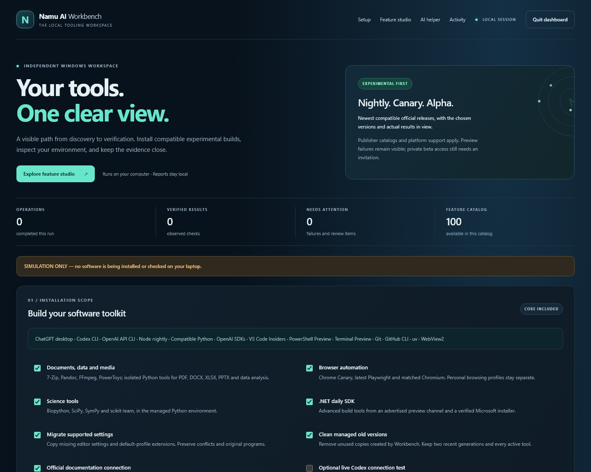
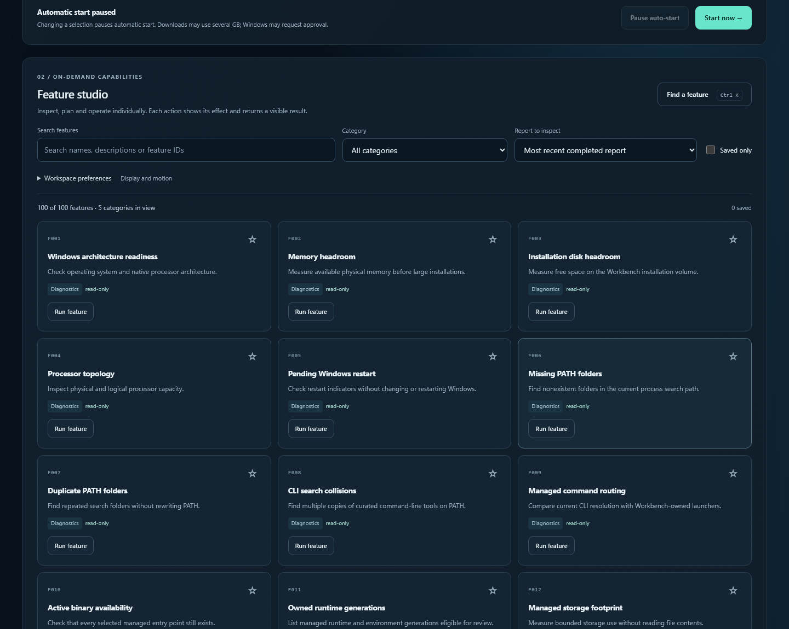
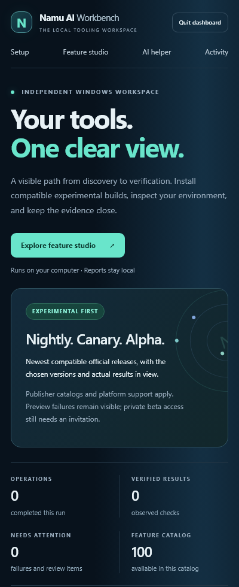
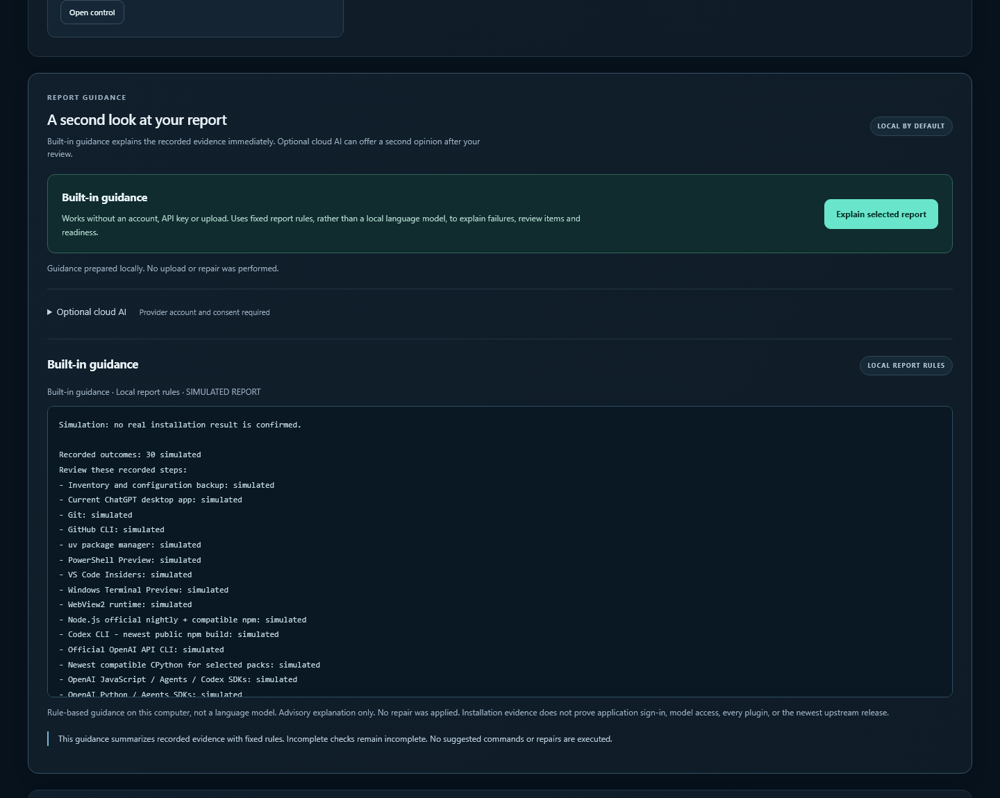

<p align="center"></p>

<p align="center">
  <a href="https://github.com/Namdev90/openai-edge-workbench/actions/workflows/verify.yml"></a>
  <a href="https://github.com/Namdev90/openai-edge-workbench/releases"></a>
  
  <a href="docs/FEATURE-CATALOG.md"></a>
</p>

<p align="center"><strong>A local Windows workspace for installing compatible experimental tools, inspecting your environment, and keeping the evidence close.</strong></p>

<p align="center"><a href="SETUP.md">Get started</a> · <a href="docs/FEATURE-CATALOG.md">100 actions</a> · <a href="docs/FEATURE-STUDIO.md">Dashboard guide</a> · <a href="source/VERIFICATION.md">Verification</a> · <a href="CONTRIBUTING.md">Contribute</a></p>

Namu AI Workbench is an independent community utility, previously presented as **OpenAI Edge Workbench**. It is separate from AMReye.AI and is not an OpenAI product. Existing launcher names and installation paths remain compatible.

## Start in one command

Paste into ordinary **Windows PowerShell** as your normal user:

```powershell
irm https://raw.githubusercontent.com/Namdev90/openai-edge-workbench/main/Run.ps1 | iex
```

The launcher updates verified application source, runs its offline checks, and opens the dashboard with all tool packs selected. A visible **12-second countdown** starts installation. Change a selection, open a feature action, or press **Pause auto-start** to review first. Windows installation approvals and account sign-in can require your input.

The short command trusts the current GitHub launcher. [SETUP.md](SETUP.md) provides the independently checksum-pinned first download, authenticated private-GitHub setup, and downloadable one-click CMD. Model requests are **off by default**, including when all tool packs are selected. The optional live Codex test uses account quota or API billing when you intentionally enable it.

## One dashboard, visible results



*Actual dashboard rendered in explicit simulation mode. This screenshot shows the interface; it is not installation evidence.*

| Workspace | What it does |
| --- | --- |
| **Install & update** | Select official public nightly, alpha, beta, Insiders, Canary and daily channels where supported. Resolve compatibility before activating managed runtimes. |
| **Inspect** | Run 30 on-demand checks for resources, command routing, ownership, provenance, runtime health and official catalogs. |
| **Understand** | Open 35 report analyses for failures, warnings, migration coverage, quotas, verification limits and changes between runs. |
| **Plan & export** | Use 25 actions: ten installation profiles, plan/dependency reviews, a local saved recipe, and JSON/Markdown/CSV/HTML/ZIP exports. |
| **Make it yours** | Use ten browser controls for search, categories, favorites, density, text size, reduced motion, log filters and a keyboard palette. |

These are **100 implemented Feature Studio actions**, numbered `studio:f001`–`studio:f100`. They include distinct analyses, presets and display controls; they are not 100 new software installers. [The catalog](docs/FEATURE-CATALOG.md) lists every action, its effect and prerequisites. [PR #1](https://github.com/Namdev90/openai-edge-workbench/pull/1) contributed a separate 100-item proposal roadmap. Its `roadmap:Fnnn` IDs and fuller acceptance criteria are tracked in [roadmap status](docs/ROADMAP-STATUS.md).

<details>
<summary><strong>See Feature Studio and the mobile layout</strong></summary>





</details>

## Tools, compatibility and preservation

The core installs ChatGPT desktop, Codex CLI, the OpenAI API CLI and SDKs, Node nightly, compatible Python, VS Code Insiders, PowerShell Preview, Terminal Preview, Git, GitHub CLI, uv and WebView2. Optional packs add document/data/media libraries and utilities, scientific Python, Chrome Canary/Playwright, and the .NET daily SDK. [Detailed supported scope](source/README.md) explains each pack.

Node nightly remains the tool runtime. npm uses the newest official private Node host satisfying its unchanged engine requirements. Python is selected only after the **entire selected package set** resolves to compatible binary wheels. Exclusions and transport failures appear in the report; unavailable private preview channels are never invented.

Workbench preserves original programs, project environments, browser profiles, credentials, Codex history and provider routes. Supported editor migration copies missing settings and default-profile extension IDs; conflicts remain for review. Cleanup removes only unused generations owned by Workbench. Historical Namu AI Edge, Device Manager and audit sources are retained as inert archives; [migration reconciliation](MIGRATION.md) records what was recovered and what is active.

## Help without configuration

**Built-in guidance** explains the completed report immediately, using local rules. It needs no account, API key, model download or coding. It labels observed outcomes and review needs; it never applies a repair automatically.

<details>
<summary><strong>See built-in report guidance</strong></summary>



</details>

Optional cloud AI supports **Groq, Google Gemini and OpenRouter**, selected from [public-apis](https://github.com/public-apis/public-apis#machine-learning) and checked against official free-access terms. Connect a provider key through the dashboard; it stays in memory for that session. Preview the exact curated summary and explicitly approve sending it. Free tiers have limits, and Gemini requires a project without linked billing. These connections are optional; installation works without them. [AI assistance guide](docs/AI-ASSIST.md).

## Reports you can audit

Reports stay on your computer:

```text
%LOCALAPPDATA%\OpenAI-Edge-Workbench\reports\<run-id>\
```

Each run records selected and observed versions, command exits, update provenance, warnings and verification limits. Use **Copy report** or inspect completed runs in Feature Studio. Exporting creates a local download; nothing is uploaded automatically. Review redaction before sharing. Keep authentication files, private backups and `local-session.json` private.

`VERIFIED` applies to the specific recorded check. `CATALOG_CURRENT`, `REVIEW_NEEDED`, failures and simulated results remain distinct. Installation, desktop behavior, cloud authorization and a real model request are separate evidence. [The verification record](source/VERIFICATION.md) distinguishes automated tests from actual Windows observations.

## Built for review

```text
source/                 Standard-library engine, protected API, dashboard and tests
docs/                   Feature guide, catalog, architecture and roadmap status
tools/                  Deterministic release build and distribution verifiers
.github/                Windows/Linux checks and contribution templates
legacy/                 Byte-preserved historical sources; never executed by setup
Setup.ps1 / Run.ps1      Verified updater and graphical first launch
release.json            SHA-256 correspondence with every embedded source file
```

The dashboard binds to loopback only. API calls require a per-session capability and exact Host; writes also require the same origin. It accepts registered actions and validated selections, with no arbitrary shell command, path or download-URL interface. Dependencies for user workloads live in managed environments; the dashboard itself uses Python's standard library and plain HTML/CSS/JavaScript.

[Architecture](docs/ARCHITECTURE.md) · [Development](docs/DEVELOPMENT.md) · [Handoff reconciliation](docs/HANDOFF-RECONCILIATION.md) · [Security policy](SECURITY.md) · [Changelog](CHANGELOG.md) · [Publisher references](source/SOURCES.md) · [Researched alternatives](ALTERNATIVES.md)

## The complete language atlas

A separate, playful [language-stat experiment](language-stat-experiment/README.md) represents **all 836 entries** in a pinned GitHub Linguist catalog, including uncommon languages and data formats. Each has a detailed reference record with its identifiers, recognition rules, aliases, file conventions and statistical group. The [searchable atlas](https://namdev90.github.io/openai-edge-workbench/) and [full catalog](language-stat-experiment/catalog.json) keep every entry visible individually. You can also download the [standalone HTML](language-stat-experiment/index.html) and open it locally.

<details>
<summary><strong>Open the complete atlas — every language, no “Other” bucket</strong></summary>


</details>

The repository deliberately classifies those reference records through documented Linguist overrides, so its native language percentages include this experiment. These are original metadata fixtures, not working implementations in 836 languages. GitHub combines related entries into parent groups and controls its own chart; the atlas displays every catalog entry separately. The experiment lives outside the installer and adds no runtimes or tool dependencies.

## Contributing and support

Use the [issue templates](https://github.com/Namdev90/openai-edge-workbench/issues/new/choose) for a redacted bug report or a concrete feature request. Read [CONTRIBUTING.md](CONTRIBUTING.md) before adding an adapter. Report security issues [privately](https://github.com/Namdev90/openai-edge-workbench/security/advisories/new).

No project license has been selected. Third-party tools retain their publisher terms; this repository does not grant rights to redistribute them.
