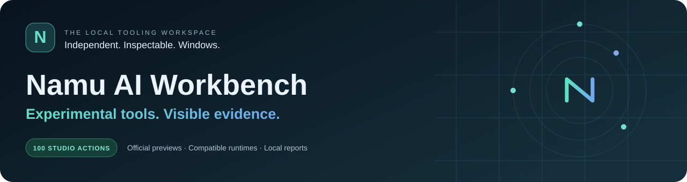
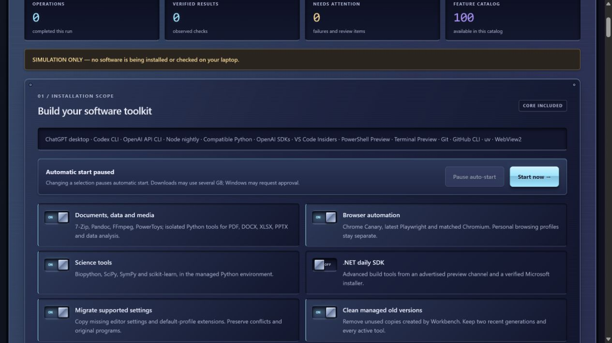
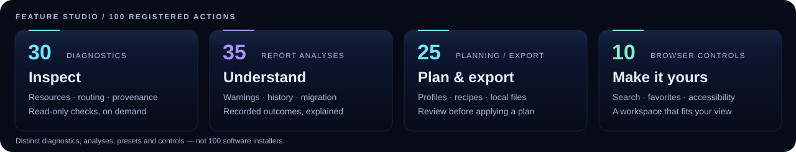
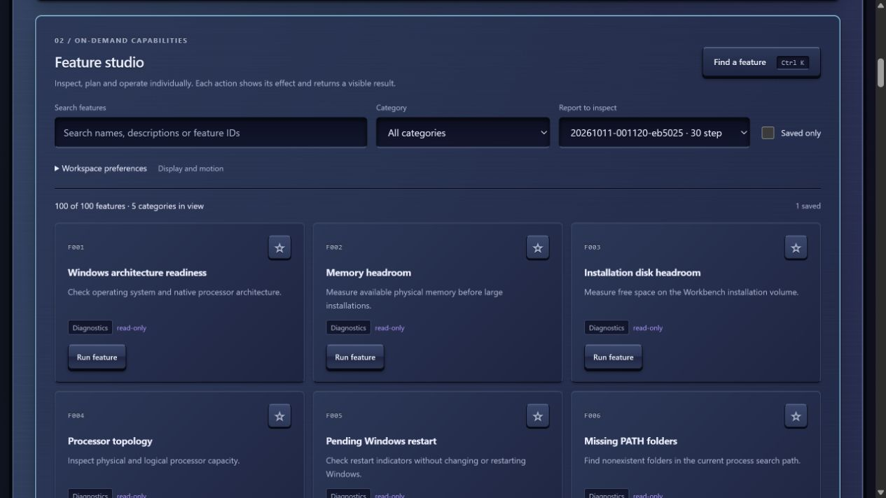
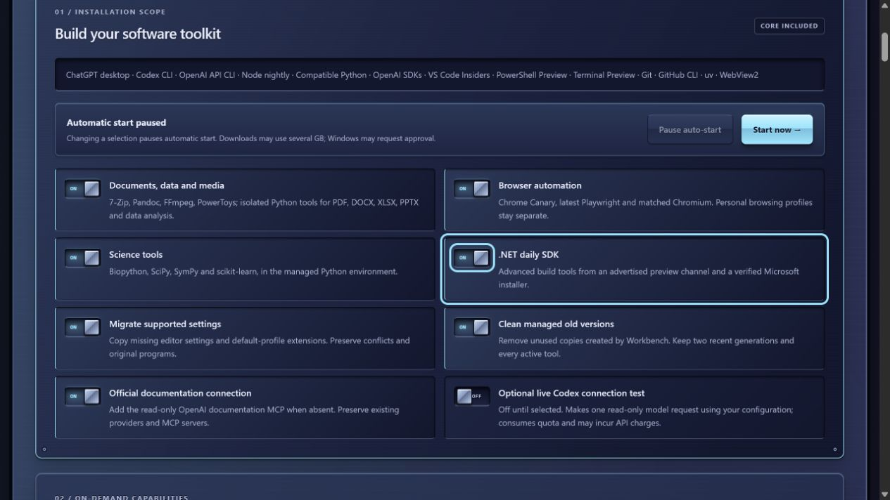
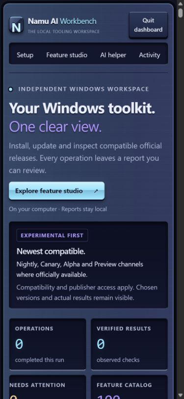
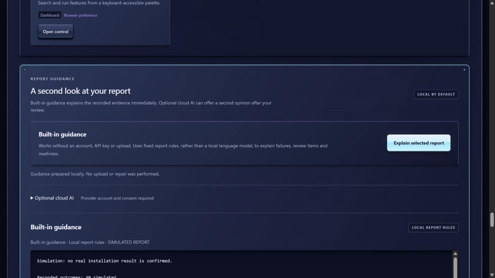
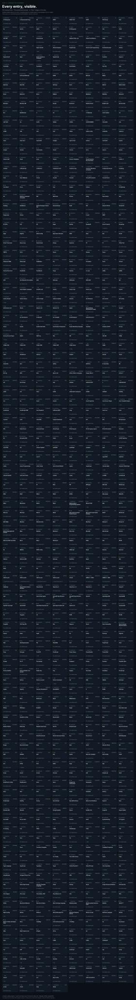

<p align="center"></p>

<p align="center">
  <a href="https://github.com/Namdev90/openai-edge-workbench/actions/workflows/verify.yml"></a>
  <a href="https://github.com/Namdev90/openai-edge-workbench/releases"></a>
  
  <a href="docs/FEATURE-CATALOG.md"></a>
</p>

<p align="center"><strong>Install compatible preview tools. Inspect your environment. Keep the evidence on your computer.</strong></p>

## Start in one command

Paste into ordinary **Windows PowerShell**, as your normal user:

```powershell
irm https://raw.githubusercontent.com/Namdev90/openai-edge-workbench/main/Run.ps1 | iex
```

**Verified application update → offline checks → graphical setup.** All tool packs start selected. The dashboard's visible **12-second countdown** begins installation; press **Pause auto-start**, change a selection, or open a feature action to review first. Windows approvals and account sign-in may require your input.

The short command trusts the current GitHub launcher. [**Setup options**](SETUP.md) include an independently checksum-pinned first download, authenticated private-GitHub bootstrap, and a downloadable one-click CMD. Model requests are **off by default**. The optional live Codex test uses quota or API billing only when you enable it.

<p align="center"><a href="docs/FEATURE-STUDIO.md">Dashboard guide</a> · <a href="docs/FEATURE-CATALOG.md">All 100 actions</a> · <a href="source/VERIFICATION.md">Verification record</a> · <a href="ALTERNATIVES.md">Alternatives</a> · <a href="CONTRIBUTING.md">Contribute</a></p>

## Your tools, one console



*The real interface in explicit simulation mode. Screenshots show the product; they are not installation evidence.*

Midnight-blue panels, recessed displays and tactile controls give the dashboard the feel of a physical instrument console. Keyboard navigation, adjustable text size, reduced motion and responsive layouts keep it usable beyond the desktop.

<p align="center"></p>

| Workspace | Capabilities |
| --- | --- |
| **Inspect · 30 actions** | On-demand resource, command-routing, ownership, provenance, runtime-health and official-catalog checks. |
| **Understand · 35 actions** | Completed-report analyses for failures, warnings, migration coverage, quotas, verification limits and changes between runs. |
| **Plan & export · 25 actions** | Ten installation profiles, plan/dependency reviews, a local saved recipe, and JSON, Markdown, CSV, HTML and ZIP exports. |
| **Make it yours · 10 controls** | Search, categories, favorites, density, text size, reduced motion, log filters and a keyboard palette. |

These are **100 implemented Feature Studio actions**, `studio:f001`–`studio:f100`: analyses, presets and display controls as well as diagnostics. They are not 100 software installers. [The catalog](docs/FEATURE-CATALOG.md) lists every effect and prerequisite. The separate [100-item proposal roadmap](docs/ROADMAP-STATUS.md), contributed through [PR #1](https://github.com/Namdev90/openai-edge-workbench/pull/1), uses `roadmap:Fnnn` IDs and fuller acceptance criteria.

<details>
<summary><strong>Explore Feature Studio, tactile controls and the mobile layout</strong></summary>







</details>

## Official channels, compatible runtimes

Select supported public **nightly, alpha, beta, Insiders, Canary and daily** channels. Workbench resolves compatibility before activating managed runtimes and records unavailable channels, exclusions and transport failures.

<details>
<summary><strong>Tools and compatibility policy</strong></summary>

The core includes ChatGPT desktop, Codex CLI, the OpenAI API CLI and SDKs, Node nightly, compatible Python, VS Code Insiders, PowerShell Preview, Terminal Preview, Git, GitHub CLI, uv and WebView2. Optional packs add document/data/media libraries and utilities, scientific Python, Chrome Canary/Playwright, and the .NET daily SDK. Availability and verification are recorded per tool; [supported scope](source/README.md) explains the packs and prerequisites.

Node nightly remains the tool runtime. npm uses the newest official private Node host satisfying its unchanged engine requirements. Python is selected only after the **entire selected package set** resolves to compatible binary wheels. Unavailable private previews are never invented, and a failed experimental install is not silently switched to an older stable runtime.

WinGet follows each tool's configured catalog/channel, which can lag its publisher. Installing software is separate from account entitlement, desktop behavior, cloud authorization and a real model request.

</details>

**Preserve what you already use.** Original programs, project environments, browser profiles, credentials, Codex history and provider routes are retained. Supported editor migration copies missing settings and default-profile extension IDs; conflicts remain for review. Cleanup removes only unused generations owned by Workbench. [Migration reconciliation](MIGRATION.md) explains the recovered Namu AI Edge, Device Manager and audit sources retained as inert archives.

## Understand the report without setup

**Built-in guidance** explains recorded outcomes with local rules. It needs no account, API key, model download or coding, and never applies a repair automatically.

<details>
<summary><strong>See built-in report guidance</strong></summary>



</details>

Optional cloud explanations support **Groq, Google Gemini and OpenRouter**, selected from [public-apis](https://github.com/public-apis/public-apis#machine-learning) and checked against official free-access terms. A connected key stays in session memory. Preview the exact curated summary and explicitly approve sending it; no automatic model call occurs. Free tiers have limits, and Gemini requires a project without linked billing. [AI assistance guide](docs/AI-ASSIST.md).

## Evidence stays close

Every run records selected and observed versions, command exits, update provenance, warnings and verification limits. Completed reports are kept locally:

```text
%LOCALAPPDATA%\OpenAI-Edge-Workbench\reports\<run-id>\
```

Use **Copy report**, review completed history, or export a local download. Nothing is uploaded automatically. Review redaction before sharing; keep authentication files, private backups and `local-session.json` private.

`VERIFIED` means the **specific recorded check** passed. `CATALOG_CURRENT`, `REVIEW_NEEDED`, failures and simulation remain distinct. [The verification record](source/VERIFICATION.md) separates automated tests from actual Windows observations.

<details>
<summary><strong>Security boundaries and source layout</strong></summary>

The dashboard binds to loopback only. API calls require a per-session capability and exact Host; writes also require the same origin. Registered actions and validated selections replace arbitrary shell, path or download-URL interfaces. The dashboard itself uses Python's standard library and plain HTML/CSS/JavaScript; workload dependencies live in managed environments.

```text
source/                 Engine, protected local API, dashboard and tests
docs/                   Guides, feature catalog, architecture and roadmap status
tools/                  Deterministic release build and distribution verifiers
.github/                Windows/Linux checks and contribution templates
legacy/                 Preserved historical sources; never executed by setup
Setup.ps1 / Run.ps1      Verified updater and graphical first launch
release.json            SHA-256 correspondence with embedded source files
```

[Architecture](docs/ARCHITECTURE.md) · [Development](docs/DEVELOPMENT.md) · [Security policy](SECURITY.md) · [Publisher references](source/SOURCES.md) · [Handoff reconciliation](docs/HANDOFF-RECONCILIATION.md)

</details>

## A complete language atlas

A separate [language-stat experiment](language-stat-experiment/README.md) represents **all 836 entries** in a pinned GitHub Linguist catalog, including uncommon languages and data formats. Detailed reference records cover identifiers, recognition rules, aliases, file conventions and statistical groups.

[**Explore the searchable atlas**](https://namdev90.github.io/openai-edge-workbench/) · [Full catalog](language-stat-experiment/catalog.json) · [Standalone HTML](language-stat-experiment/index.html)

<details>
<summary><strong>View every catalog entry individually</strong></summary>



</details>

These are **original metadata fixtures, not working implementations in 836 languages**. Documented Linguist overrides deliberately include them in native repository statistics. GitHub groups related entries and controls its chart; the atlas displays every entry separately. The experiment stays outside the installer and adds no runtimes or tool dependencies.

## Project and support

**Namu AI Workbench** is an independent community utility, previously presented as OpenAI Edge Workbench. It is separate from AMReye.AI and is not an OpenAI product. Existing launcher names and installation paths remain compatible.

Use the [issue templates](https://github.com/Namdev90/openai-edge-workbench/issues/new/choose) for a redacted bug report or concrete feature request. Read [CONTRIBUTING.md](CONTRIBUTING.md) before adding an adapter, and report security issues [privately](https://github.com/Namdev90/openai-edge-workbench/security/advisories/new).

[Changelog](CHANGELOG.md) · [Visual identity](docs/BRAND.md) · [Researched alternatives](ALTERNATIVES.md)

No project license has been selected. Third-party tools retain their publisher terms; this repository does not grant rights to redistribute them.
