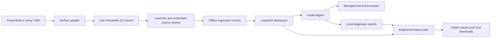

# Architecture

Namu AI Workbench is a local Windows maintenance application with a Python standard-library server and a plain browser dashboard. Workload packages are isolated from the GUI runtime.

## Install engine

`source/engine.py` declares curated package adapters and builds a plan from eight boolean choices. Core components always run; profiles select optional packs rather than individual core components. Runtime candidates are resolved and checked before activation. Existing managed environments remain selected when a candidate fails. Reports record command exits, exact-version evidence and limitations.

`Setup.ps1` resolves one `main` commit and validates every embedded application file against `release.json`. GitHub CLI handles private access. `tools/build_release.py` deterministically packages source and tests into the standalone CMD; verifiers compare bytes. Offline cached launches recheck integrity and disclose the failed update.

## Feature Studio

`feature_hub.py` combines an exact contiguous 100-entry catalog. `app.py` exposes protected discovery, completed-report history, job submission and lookup. Requests can select a registered feature, completed run ID and validated options; they cannot supply code, paths, URLs or commands.

| Module | IDs | Responsibilities |
| --- | --- | --- |
| `feature_diagnostics.py` | f001–f030 | Resource, routing, integrity, runtime and official-catalog observations |
| `feature_reports.py` | f031–f065 | Pure completed-report analyses; no command execution or environment reads |
| `feature_plans.py` | f066–f090 | Profiles, plan explanations, local exports and owned recipe storage |
| `app.js` | f091–f100 | Browser preferences, search, favorites, log filters and keyboard palette |

Server features run asynchronously, with two active jobs and 30 retained session results. History scans at most 200 recognized directories, reads completed JSON reports up to 2 MiB, and exposes at most 60. Partial, malformed and unsafe paths are excluded. Catalog requests allow official HTTPS hosts, same-host redirects and response-size/time bounds. Simulation skips diagnostic subprocesses and network probes.

## Local authorization and data

A launch holds an OS instance lock and creates a random loopback port and capability. HTML receives the capability through the URL fragment; JavaScript uses an API header. The server checks Host and same-origin writes, disables framing and applies a restrictive Content Security Policy. The private local session record is removed on normal quit.

Results render as text. Sensitive fields and common credential patterns are redacted before serialization; HTML is escaped and CSV formulas neutralized. Support ZIPs contain only the sanitized selected report, summary and checksums. Recipe writes use a marked directory and preserve unknown files. Browser preferences contain display choices and feature IDs, not account material.

## Evidence boundaries

Tests, simulation, local executable observations, signed-in desktop checks and cloud round trips are separate evidence. Process exit never hides structured doctor warnings. Catalog freshness is established only where a live official comparison is available. See [verification](../source/VERIFICATION.md) and [roadmap reconciliation](ROADMAP-STATUS.md).
